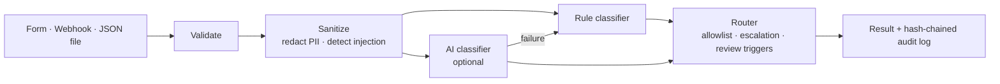

# AI Intake & Cybersecurity Triage Automation

A Python service that takes support and security intake requests from a web form, a webhook or a JSON file. For each one it:

1. validates and sanitizes the request,
2. classifies it with an optional AI model, falling back to deterministic rules,
3. assigns a priority and routes it with a config-driven allowlist,
4. flags it for human review when risk or uncertainty is high, and
5. records the decision in a tamper-evident audit log.

All data in this repository is simulated.

## Business problem

Help desks and security teams often receive requests through one shared channel. Phishing reports sit next to billing questions, and a ransomware report can wait in the same queue as a printer ticket. Manual triage is slow and inconsistent, and it depends on whoever happens to read the ticket first. This project automates the first-pass decision while keeping a person in the loop for anything high-risk, ambiguous or suspicious.

## How it works



**The AI proposes; the rules decide.** The AI model can only suggest a category, priority and confidence. The destination comes from [config/triage_rules.json](config/triage_rules.json), and escalation keywords set a priority floor the AI can't lower. See [docs/architecture.md](docs/architecture.md).

### Categories and routing

| Category | Destination | Base priority |
|---|---|---|
| malware_suspected | security_incident_response | P2 |
| data_exposure | security_incident_response | P2 (always reviewed) |
| phishing_report | security_incident_response | P2 |
| account_access | identity_access_team | P3 |
| access_request | identity_access_team | P4 |
| technical_support | it_helpdesk | P3 |
| billing | billing_team | P4 |
| general_inquiry | general_support_queue | P4 |
| unknown | human_triage | P3 (always reviewed) |

### Human-review triggers

A request goes to human review if any of these is true: priority P1, confidence below 0.6, unknown or sensitive category, suspected prompt injection, redacted PII or secret, AI failure (fallback used), or disagreement between the AI and the rules.

## Setup

Requires Python 3.11 or newer. Tested with Python 3.12.16 on macOS 15.6.

```bash
python3.12 -m venv .venv
source .venv/bin/activate
pip install -e ".[dev]"
```

No Python 3.11+ installed? [uv](https://docs.astral.sh/uv/) can install one without admin rights: `uv python install 3.12 && uv venv --python 3.12 .venv`.

Optional AI mode: `pip install -e ".[llm]"`, copy `.env.example` to `.env`, and set `TRIAGE_LLM_PROVIDER` and the matching API key.

## Usage

```bash
triage process data/samples/sample_requests.json --rules-only
triage serve            # form at http://127.0.0.1:8000, webhook at POST /intake, API docs at /docs
triage verify-log       # check the audit log hash chain
```

Webhook example:

```bash
curl -s -X POST http://127.0.0.1:8000/intake -H "Content-Type: application/json" \
  -d '{"subject":"VPN keeps disconnecting","description":"The VPN drops every few minutes."}'
```

## Testing

```bash
pytest -v
```

The tests use only simulated data, and a fake replaces the AI provider, so they never make network calls.

## Verified results

From the run recorded in [docs/results_report.md](docs/results_report.md) (2026-11-05):

| Check | Result |
|---|---|
| Automated tests | 107 passed, 0 failed |
| Batch triage, 13 simulated requests (rules-only) | 13 triaged, 7 flagged for human review; all matched the expected category, priority and destination |
| Invalid requests | 5 of 5 rejected with field-level messages |
| Prompt injection sample | Detected and flagged; routing unchanged |
| Audit log | Hash chain verified; a modified entry was detected at the exact line; 0 PII matches in the log |
| Webhook | 200 / 422 / 400 / 413 / 401 returned as designed |
| AI provider failure (invalid key, real API) | 401 handled, request triaged by the rule-based fallback and flagged |

The sample requests and rules were written together, so these results show that the logic behaves as designed. They are not an accuracy benchmark. AI classification with a valid API key hasn't been verified yet.

## Security considerations

Covered in [docs/security.md](docs/security.md): input validation, minimal data collection, PII and secret redaction, prompt-injection handling, secret management, fail-closed audit logging, and the limitations of each.

## Limitations

- The keyword classifier is simple and was tuned on the 13 sample requests. It hasn't been evaluated on real ticket data.
- Redaction and injection detection are heuristics.
- There's no user authentication, rate limiting or persistent queue. This is a single-process demo.
- AI mode sends redacted text to a third-party provider.

## Future improvements

- Evaluate the classifiers on a labelled dataset and report precision and recall per category.
- A human-review queue UI with reviewer decisions fed back as labels.
- Signed or write-once audit storage.
- Real ticketing integrations (Jira Service Management, ServiceNow) in place of destination names.
- Rate limiting and proper authentication (OAuth / API keys per client).

## Project structure

```
config/        routing rules (version-controlled)
src/triage/    application code
templates/     web form
data/samples/  simulated requests
tests/         pytest suite
docs/          architecture, security, results, demo script
integrations/  optional n8n guide
```
