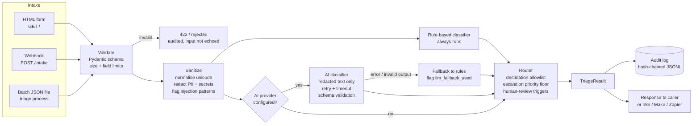

# Architecture

## Request flow

## Trust boundaries

| Boundary | Untrusted side | Control |
|---|---|---|
| HTTP → app | Request body, headers | Optional shared-secret header (constant-time compare), 20 KB body cap, strict schema, `extra="forbid"` |
| App → AI provider | Ticket text | Redacted before sending; wrapped in `<ticket>` tags; system prompt says to treat it as data |
| AI provider → app | Model output | Parsed as JSON, validated against enum allowlists; destination never taken from the model |
| App → audit log | Decisions | Hash-chained; raw text excluded; writes fail closed |

## Module responsibilities

| Module | Responsibility |
|---|---|
| `models.py` | Data contracts, category/priority enums, destination allowlist |
| `config.py` | Environment settings (secrets hidden from repr) and rules-file validation |
| `sanitize.py` | Unicode normalisation, PII/secret redaction, prompt-injection heuristics |
| `classifier_rules.py` | Deterministic keyword classifier (fallback and baseline) |
| `classifier_llm.py` | Optional Anthropic/OpenAI classifier with output validation |
| `reliability.py` | Exponential-backoff retry for transient errors |
| `router.py` | Destination, escalation floor, human-review reasons |
| `pipeline.py` | Orchestration and audit writes |
| `audit.py` | Append-only hash-chained log and verifier |
| `api.py` / `cli.py` | HTTP and command-line entry points |

## Key design decisions

1. **AI proposes, rules decide.** The model's output is limited to category, priority, confidence and rationale. Routing comes from a version-controlled rules file, so prompt injection can't redirect a ticket.
2. **The rule classifier always runs.** It provides the fallback and a second opinion. When the AI and the rules disagree, the request goes to human review.
3. **Escalation is a floor, not a suggestion.** Phrases like "ransomware" or "entered my password" raise the priority whichever classifier ran.
4. **Fail closed on audit.** If the audit log can't be written, the API returns 503 instead of an unrecorded decision.
